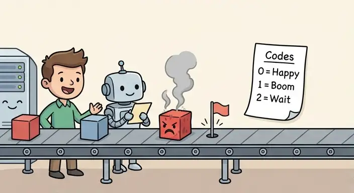
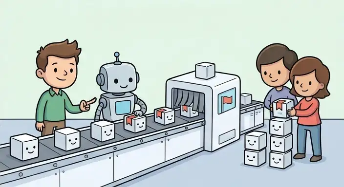

I've been thinking about programming language design for several years while creating my own language, **Menehune**. Along the way, I've worked on mechanisms for problems that have traditionally only been solved in a handful of ways. This is the first post in a (tentative) series: a different way of implementing exceptions, with a completely different set of tradeoffs.

So... What if exceptions didn't require stack unwinding, heap allocation, or a runtime library, but still kept the clean ergonomics of try/catch? Before we get to that, let's look at the current landscape.

---

## In the beginning, there were error codes



The oldest mechanism is the return value. A function returns an integer where some values mean success and others failure, and the caller manually checks it. C and POSIX are the canonical examples: `open` returns a file descriptor or `-1`, `read` returns a count or `-1`, and global `errno` carries the detailed failure state. You know all those `ESOMETHING` errors that POSIX declares? Yeah, those.

It's really cheap - a return value fits in a register. There is no runtime machinery, no allocation, no unwinding, and no runtime library. It works seamlessly in a kernel, a bootloader, or a microcontroller - anywhere a function can return.

Additionally, there’s usually a `strerror` function that takes an `ESOMETHING` value and gives you a static string explaining what the error means - a pattern you see replicated everywhere from POSIX to custom C libraries. It’s useful for debugging, but it means your error descriptions are locked behind global tables or manual conventions.

It's also easy to ignore. Nothing forces the caller to check the return value. The compiler can't reliably tell you that you forgot because the error is *a convention, not a distinct type*. Additionally, the error code has to share the return value's range, stealing a slice of the valid domain: `-1` isn't a valid file descriptor, `NULL` isn't a valid pointer, and every API has to carve out its own reserved error domain.

---

## Next, types made the error part of the value



Functional programming - and, later, Rust - fixed the "easy to ignore" problem by embedding the error in the type signature. A function returns a `Result<Value, Error>`. The caller physically cannot access the value without unwrapping or handling the error.

This is a massive structural improvement. The compiler enforces handling and the type system tracks it across calls. No reserved sentinel values, no `errno`, and no hidden conventions.

The cost is that error propagation is *viral*. Every function that can fail must return an error type, which forces every caller to propagate or handle it explicitly up the call graph. Languages work around this with syntactic sugar like `?`, `try!`, or monadic `do` notation. You still need to write the `?` at every single call site, or write an explicit `match`.

---

## Then the stack unwound to a handler


C++, Java, C#, Python, and JavaScript took a third path: treating the error as a *control-flow event* rather than a returned value. You `throw`, the runtime walks and unwinds the stack to the nearest `try` block, and the matching `catch` block executes.

This is the most *ergonomic* approach so far. The call site doesn't need explicit syntactic markers, propagation is entirely implicit, and the error handler is visually separated from the happy path. The `try`/`catch` block reads clearly, leaving the primary flow as-is.

The cost is that the mechanism is *invisible* and *expensive*. Unwinding requires a complex runtime stack walk. Compilers must emit `.eh_frame` unwind tables, landing pads, and personality functions for every function that might throw. In C++, that effectively means *every function with a destructor*, whether it ever throws or not! Under the Itanium C++ ABI, this static table bloat and metadata management add a substantial cost, paid up front. The format may be called DWARF, but the binaries are anything but short.

That static binary size penalty, alongside heap allocations for thrown objects and unpredictable dynamic timing is why critical software like OS kernels disable exceptions entirely. macOS drivers are written in C++ without exceptions - not because error handling is undesirable, but because stack walking, unwind tables, and runtime allocations are unacceptable in low-latency or kernel-space constraints.

---

## Greedy design: Taking the best of all worlds

Each of the three paradigms above puts the error somewhere:

* **Error codes** put it *out of band* via convention.
* **Types** put it *in the value* via the type system.
* **Unwinding** puts it *in control flow* via the runtime stack walk.

What none of them do is provide an error mechanism that is **zero-cost on the happy path, allocation-free, and ergonomic at the same time**.

My design for Menehune aims to hit that fourth point in the design space: **an exception is a return value with a flag, and that flag is the only difference between a throw and a normal return.**

## The Method

The core concept boils down to one sentence: **an exception is a return value carrying an in-flight flag.**

There is no stack scanning, no `.eh_frame`, no personality functions, no heap allocation, and no runtime library. The throw path and the standard return path use the exact same machine instructions, differentiated only by a flag bit that is almost always clear.

The design relies on three primary components:

### 1. The ID is a value, not a control-flow event

An exception payload is represented as a 64-bit numerical ID. The way we represent the flag depends on the target:

* **x86-64 (Register-Starved):** x86-64 has a notoriously sparse general-purpose register set. Sacrificing a precious GPR purely for an in-flight boolean flag adds register pressure. Instead, we reuse status flags via `stc` (Set Carry Flag):
```asm
mov rax, <64-bit exception ID>   ; Load exception payload
stc                              ; Set in-flight carry flag
ret                              ; Return immediately to caller

```

* **ARM64 / RISC-V (Register-Rich):** Architectures with 31+ general-purpose registers can avoid messing with CPU flag states entirely by dedicating a secondary return register:
```asm
mov x0, <64-bit exception ID>   ; Load exception payload
mov x1, #1                      ; Set in-flight error flag
ret                             ; Return immediately to caller

```

Three instructions either way. The throw *is* a return.

### 2. The ABI Contract: Signature Annotations

Standard function ABIs treat flags and secondary scratch registers as volatile so Menehune requires functions that can throw to be explicitly annotated with `throw` in their signature.

This isn't just a static analysis lint - it is an explicit ABI contract:

* **Non-throwing functions** use standard calling conventions. They pay zero register overhead and require no defensive code generation.
* **Throwing functions** (and callers propagating them) compile with the extended return/flag convention.

Because non-throwing functions cannot throw, the compiler doesn't need to generate handling code around them. The happy path remains clean machine code.

### 3. The 64-bit ID is split by consumer

The 64-bit Exception ID cleanly splits responsibilities:

```
[ Library ID: 16 bits | Exception ID: 16 bits | Source ID: 32 bits ]

```

* **Library ID (16 bits):** Assigned by the linker at load time via relocation. Identifies which shared library or module owns the exception.
* **Exception ID (16 bits):** Assigned by the compiler when the exception type is declared. Identifies the specific exception within that library.
* **Source ID (32 bits):** Encodes the exact call-site line and metadata reference. It is never read by the runtime during normal execution.

The low 32 bits (`Library ID` + `Exception ID`) are consumed by the **runtime** to map the exception to its static string message - essentially a modern take on `strerror`. The high 32 bits (`Source ID`) are reserved for **debuggers or panic handlers** to pinpoint the exact source location. The runtime never reads the debug bits during execution, and the debugger doesn't need to query dynamic tables to trace the origin.

### 4. Link-time assignment, no dynamic registration

Because the `Library ID` is populated via load-time relocations, exception IDs remain stable across separate dynamic libraries without needing a dynamic runtime registry.

Exception text strings live directly in `.rodata` as standard static strings. Adding a new exception type within a library does not shift existing IDs, keeping the ABI stable. Adding an entire library simply yields a new `Library ID` relocation slot, leaving existing modules completely untouched.

---

## How Menehune Handles Propagation and Catching


In Menehune, ergonomics match standard `try`/`catch` expectations without the underlying unwinding cost:

1. **Automatic Propagation:** A function marked `throw` can call another throwing function without explicit `?` or `try` wrapping. The compiler emits a single fast check after the call instruction (e.g., testing the carry flag or register status). If the flag is set, the function immediately returns, passing the in-flight indicator up to its caller. The only slight complication happens if destructors need to run first, in which case the flag must be set again before returning.
2. **Exhaustive Catching:** A non-throwing function calling a throwing function must wrap the call in a `try` block with exhaustive `catch` clauses. If an exception can escape an unannotated function, it is caught at compile time.

To enforce exhaustiveness across compilation boundaries without full whole-program recompilation, Menehune uses **incremental TUs (Translation Unit) summaries**. Each compiled translation unit emits a compact summary of its thrown exception set alongside the `.o` file. At import time, the compiler quickly merges these summaries - giving whole-program verification semantics at incremental build speeds.

---

## The Load-Bearing Constraint: Destructors Cannot Throw

The foundational rule that makes this model possible is simple: **destructors cannot throw.** In Menehune, attempting to throw from a destructor is a compile-time error.

C++ technically permits throwing destructors, but in practice, doing so during stack unwinding triggers `std::terminate`. The universal guidance across the C++ ecosystem is "never throw from a destructor," leading `noexcept` to become the default in modern C++. C++ pays for the *possibility* of throwing destructors across every single stack frame, even though virtually no real-world code uses them.

By strictly enforcing this rule at the language level, Menehune reaps the reward: zero unwind tables, zero personality functions, zero landing pads, and zero runtime overhead.

---

## Performance Summary

| Phase | Cost |
| --- | --- |
| **Throw** | 3 instructions |
| **Propagation (no destructors)** | 1 instruction check + `ret` |
| **Propagation (with destructors)** | Standard cleanup calls + 1 instruction flag reset |
| **Catch (Happy Path)** | 1 flag/register check after the call |
| **Catch (Dispatch)** | A few integer compares on the ID |
| **Message Lookup** | Static table offset into `.rodata` |
| **Source Tracking** | Zero runtime cost (relegated to debug symbols) |
| **Runtime Dependency** | None |

Compared to traditional unwinding mechanisms, the throw path in Menehune is `O(1)` regardless of how deep the call stack is.

---

## What is Lost?

The primary limitation of this design compared to heap-allocated C++ exception objects is that **exception messages cannot be dynamically formatted strings created at runtime.** The error message is a static string residing in `.rodata`.

However, in systems programming, this is rarely a true deficit:

* The **Exception Type** carries the program semantics for handling logic.
* The **Structured Payload Fields** carry dynamic state (e.g., error code numbers, missing IDs).
* The **Source ID** pinpoints the line of code that failed.

Formatting dynamic text strings for exceptions is usually a workaround for poorly typed error structures.

---

## If this is so great, show me the code!

I can't... I haven't actually implemented it yet.
And my realization about how much of a different problem space actual compiler implementation is compared to language design is one of the reasons I decided to share this post.
I would genuinely like to see it implemented because I think it's a better point in the design space than the alternatives I presented earlier.

---

## Conclusion

Kernels and embedded systems don't avoid exceptions because clean error propagation is bad; they avoid them because stack-walking runtimes, unwind tables, and non-deterministic dynamic allocations are fundamentally incompatible with their operating environment.

Menehune's approach treats an exception for what it actually is at the CPU level: a value returned along the standard control-flow path with a flag bit set. By pairing this representation with strict rules around non-throwing destructors and signature annotations, we get the ergonomics of `try`/`catch` in domains where exceptions were previously considered impossible.
