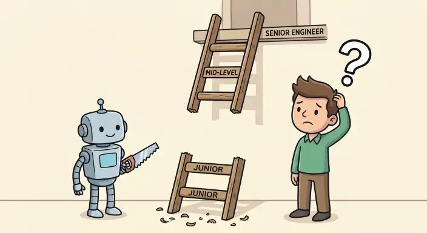

> *Disclosure: In keeping with the workflow described in this post, the thesis, systems perspective, and arguments here are entirely my own, while an LLM was used as a sounding board to help organize the structure and refine the phrasing.*

I originally sat down to write this piece in a vacuum - a reflection on why the current industry consensus treating code writing as an obsolete, mechanical step is *dangerously* wrong. Then, doing what any reasonable engineer should do before building something from scratch, I looked for prior art.

It turns out that [Christian Ekrem already articulated this core thesis](https://cekrem.github.io/posts/programming-as-theory-building-naur) over a year ago, connecting [Peter Naur’s 1985 essay *Programming as Theory Building*](https://pages.cs.wisc.edu/~remzi/Naur.pdf) to the rise of reflexive LLM code generation. Rather than reinventing the wheel, I want to build on that foundation and look at how this exact problem plays out in **low-level systems engineering** - and why the common management view of code misses the point.

---

## Theory building near the metal
Naur’s central point is that a program is not just its source code; it is the **mental model** held by the people who built it - its invariants, edge cases, and the reasoning behind every trade-off. Writing code is not merely a translation of intent into syntax; it is also the cognitive exercise of constructing and stress-testing that mental model, constantly refining it as previously held assumptions are verified or negated.

In application code, a missing mental model often shows up as architectural drift or messy abstractions. In systems programming - kernels, hypervisors, runtimes, and compilers - a missing mental model shows up as **silent memory corruption, global mutex deadlocks, broken async-signal safety, or subtle ABI mismatches** that only surface under extreme production load.

Let us not forget about ever-changing requirements and scope creep either. An application designed at a certain point in time may have had reasonable assumptions about its invariants and overall design that needed to be challenged and refined as user needs expanded. Without someone holding the original mental model, modifying those invariants safely becomes guesswork.

---

## The L3 debugging reality

If you spend years triaging and fixing defects at the boundary between kernel space and user space under enterprise SLAs, you quickly learn that writing the initial patch is the cheapest part of a feature’s lifecycle. The real cost is paid over the next five years when something breaks at 3:00 AM.

Auditing and debugging hundreds of lines of plausible-looking generated code requires far more cognitive effort than writing clean, intentional code yourself. When code is accepted into a repository without an author who truly owns its mental model, `git blame` stops pointing to someone who knows *why* a memory barrier or a lock ordering rule exists. Every non-trivial bug turns into an archaeological expedition.

At times, you may even find yourself needing to port modern software onto an older platform - a role I like to call **"reverse archaeologist,"** as you are essentially burying new treasures inside an ancient civilization. That kind of work requires careful planning, deliberate design, and surgical execution. AI can certainly assist with the mechanical implementation details, but you must strictly guide the architecture if you have any hope of making the result maintainable.

---

## Software is not *solely* a means to an end

A common refrain from management, especially as of late, is that code is merely a "means to an end" - it exists solely to solve a user problem, so how it gets written does not matter as long as the feature ships.

The flaw in that argument lies in the word *solely*.

Consider how a car is engineered. A car does not exist exclusively to move its driver from point A to point B. Its design must also account for the safety of other drivers on the road, pedestrian impact zones in the event of an accident, and - crucially - serviceability so a mechanic can actually diagnose and replace parts when something breaks down. Nobody welds the hood shut just because the driver never looks inside while driving.

Production software carries the exact same secondary obligations:
* **Safety and containment:** Respecting memory boundaries, avoiding resource exhaustion, and failing predictably so a defect in one component does not take down neighboring systems.
* **Serviceability:** Clear invariants, modular boundaries, and human-owned mental models so the engineers on call can actually diagnose and repair the system when it breaks years later.

Treating code generation as an assembly line that skips human understanding is the software equivalent of welding the engine block to the chassis. It might roll off the factory floor faster, but it becomes a write-off the first time it needs real maintenance.

---

## Where LLMs actually belong in a systems workflow
Rejecting blind code delegation does not mean rejecting modern tools. Used deliberately, LLMs are genuinely useful force multipliers when kept strictly outside the critical path of core authorship:

* **Architectural sparring:** Stress-testing trade-offs between design options you have already formulated.
* **Navigating unfamiliar codebases:** Summarizing call paths or explaining legacy subsystems before you dive into the source.
* **API exploration:** Generating quick, disposable examples to see how an unfamiliar library or syscall behaves.
* **Mechanical boilerplate:** Automating repetitive glue code, test harnesses, or build configuration scaffolding that carries low architectural risk.

---

## Keep authorship where accountability lives
The code that gets merged into a codebase - the code your team will be responsible for maintaining and debugging under pressure - should still be written, line by line, by the engineers who own it. Tools can accelerate exploration and eliminate tedium, but they cannot carry architectural accountability.

---

## The broken pipeline and the coming price hike

This shift does not just degrade existing codebases; it creates a dangerous economic and demographic trap for the industry.

Breaking into the field as a junior developer was already hard enough. Now, many organizations are shrinking entry-level hiring under the assumption that LLMs can handle routine tasks faster and cheaper than a junior engineer. That logic has two fatal blind spots:

* **Senior engineers are not born - they are grown:** Every senior systems engineer today got there by starting at the bottom, writing real code, breaking things, debugging their own mistakes, and gradually building mental models under the guidance of experienced peers. Replace entry-level roles with code generators today, and you eliminate the exact training ground needed to produce the next generation of seniors.
* **Subsidized lock-in:** Current LLM pricing is heavily subsidized by providers operating at a loss to capture market share. If an entire generation of developers grows up unable to write or debug systems without model assistance - and fewer senior engineers remain to step in - providers will hold total leverage. Once the subsidies end and prices inevitably climb, organizations will have no internal capability left to fall back on.

---

## The inevitable bill comes due

I could construct a hypothetical strawman of what happens when organizations push velocity over deep architectural understanding - shipping massive, opaque changes while losing sight of how failure modes interact - but I hardly need to. We just watched (on 2026/11/13) the global Microsoft 365 outage unfold over 18 hours, taking down Exchange Online, Outlook, and Teams for millions of users worldwide.

Whether a specific cascade is triggered by a botched network capacity change, broken health-check logic, or unexamined assumptions across tightly coupled services, the lesson is the same: complex distributed systems fail in ways that defy superficial fixes. Notice how Microsoft’s initial remediation attempts failed to behave as expected, forcing engineers into slow, manual traffic rerouting and gradual server isolation while the world waited - and how quickly the company had to issue statements denying AI involvement after touting AI-accelerated patch volume just days earlier.

When systems are changed faster than humans can maintain a coherent mental model of their failure modes, recovery stops being deterministic engineering and turns into crisis management. As more codebases are flooded with plausible-looking code that nobody truly owns, the engineers who actually understand how systems behave beneath the abstraction are not becoming obsolete - they are simply waiting for the maintenance bill to arrive.
